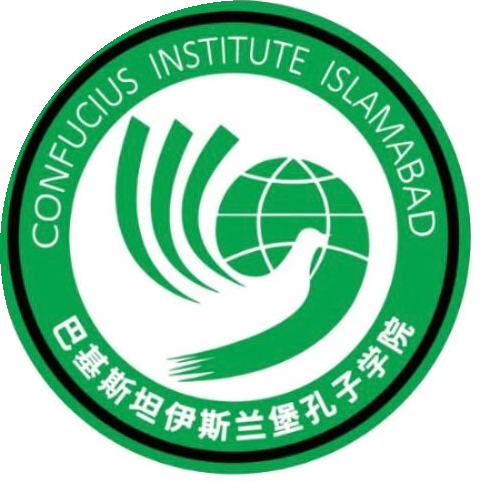

  

  
  
  
  
  
  

  

**[Who we are](#who-we-are)** · **[Programmes](#programmes)** · **[Join](#how-to-join)** · **[Honours](#honours)** · **[People](#people)** · **[Campus life](#campus-life)** · **[Contact](#visit-us)**

---

## Who we are

The **Confucius Institute Islamabad** at the **National University of Modern Languages (NUML)** is the first Confucius Institute in Pakistan and the first in the Islamic world. The contract was signed in **April 2005**, in partnership with **Beijing Language and Culture University (BLCU)**.

Chinese and Pakistani teachers deliver language training and organise Chinese competitions, cultural performances and exchange programmes between the two countries.

> *Virtue in Conduct, Excellence in Speech, Fostering Global Harmony.* 
> The BLCU motto the institute works by

 

## Programmes

<table>
  <tr>
    <td width="50%" valign="top">
      <h3>📘 Chinese language</h3>
      Six proficiency levels, <b>HSK 1 → HSK 6</b>, from first sounds and characters to advanced communication.
    </td>
    <td width="50%" valign="top">
      <h3>🏮 Culture</h3>
      The <b>Chinese Bridge</b> competition, cultural workshops, interactive activities and exchange events.
    </td>
  </tr>
  <tr>
    <td valign="top">
      <h3>🧑‍🏫 Training</h3>
      Teacher training, and winter and summer study programmes at <b>BLCU</b>.
    </td>
    <td valign="top">
      <h3>🎓 Scholarships</h3>
      Confucius Institute scholarships: six-month, one-year, bachelor's and master's study.
    </td>
  </tr>
</table>

## How to join

<a href="https://www.confuciusinstituteislamabad.com/registration"><b>Start your application →</b></a>

## Honours

| Year | Recognition |
|:---:|---|
| **2007–2012** | 🏆 Best Confucius Institute of the Year, four times |
| **2015** | 🌏 Global Model Confucius Institute |
| **2015** | 🤝 *Five Principles of Peaceful Coexistence* Friendship Award, presented to NUML during President Xi Jinping's state visit to Pakistan |
| **2017** | 🎖️ Excellent Award for the Chinese Language Examination |

## People

<b>Leadership</b>

 

| Name | Role |
|---|---|
| Maj Gen Shahid Mahmood Kayani HI(M), Retd. | President of the Confucius Institute and Rector of NUML |
| Dr. Shao Yang | Vice President and Chinese Director |

<b>Teaching faculty</b>

 

| Name | Role |
|---|---|
| Arslan Mehmood | Head Teacher and Lecturer in Chinese |
| Motia Zaman | Lecturer and Coordinator |
| Amna Gillani | Chinese Language Instructor and Translator |
| Abdul Salam | Chinese Language Teacher and Translator |
| Ai Chun Ling | MA Chinese Linguistics and Literature |

Full profiles are on the [faculty page](https://www.confuciusinstituteislamabad.com/faculties).

## Campus life

| When | Story |
|---|---|
| Fall 2026 | [A two-day orientation welcomes the new students](https://www.confuciusinstituteislamabad.com/news/orientation-session-fall-2026) |
| September 2026 | [International Confucius Institute Day: song, calligraphy, martial arts and student awards](https://www.confuciusinstituteislamabad.com/news/international-confucius-institute-day-2026) |
| May 2026 | [Huawei recruitment fair: careers, internships and the value of Chinese](https://www.confuciusinstituteislamabad.com/news/huawei-recruitment-fair-2026) |

## Visit us

<table>
  <tr><td>📍 <b>Address</b></td><td>Confucius Institute, NUML Main Campus, Sector H-9/4, Islamabad</td></tr>
  <tr><td>✉️ <b>Email</b></td><td><a href="mailto:info-cii@numl.edu.pk">info-cii@numl.edu.pk</a></td></tr>
  <tr><td>☎️ <b>Phone</b></td><td><a href="tel:+92519265100">+92 51 9265100</a></td></tr>
  <tr><td>🕘 <b>Hours</b></td><td>Monday – Friday, 08:30 – 16:30 PKT</td></tr>
  <tr><td>🌐 <b>Web</b></td><td><a href="https://www.confuciusinstituteislamabad.com">confuciusinstituteislamabad.com</a></td></tr>
</table>

<b>中文简介</b>

 

**伊斯兰堡孔子学院**设于巴基斯坦国立现代语言大学（NUML），是巴基斯坦第一所、也是伊斯兰世界第一所孔子学院。合作协议于**2005年4月**签署，中方合作院校为**北京语言大学**。

学院开设HSK 1至6级中文课程，举办“汉语桥”中文比赛和各类文化活动，提供教师培训、赴华研修及孔子学院奖学金。

[访问中文网站 →](https://www.confuciusinstituteislamabad.com/zh)

---

**学中文，交朋友** · Learn Chinese, build friendships

